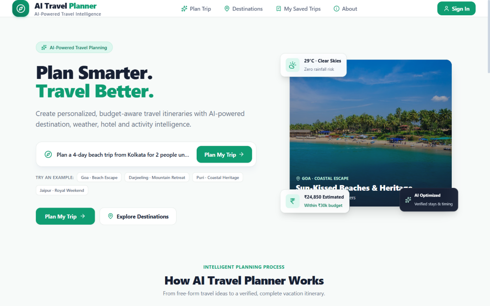
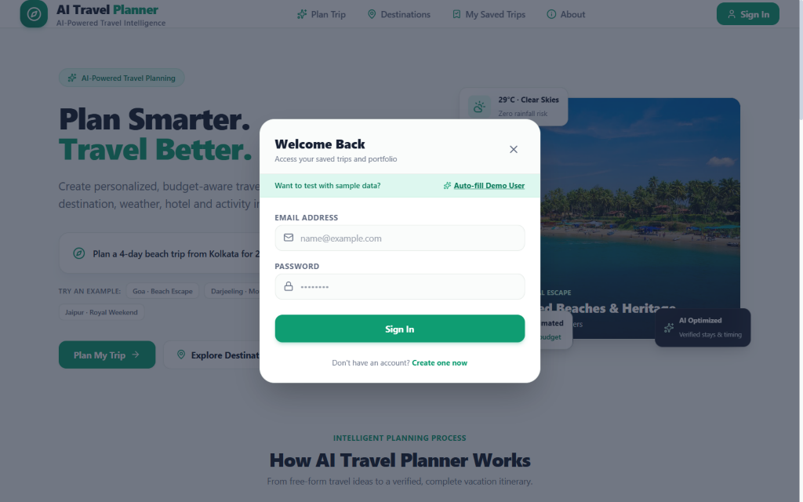
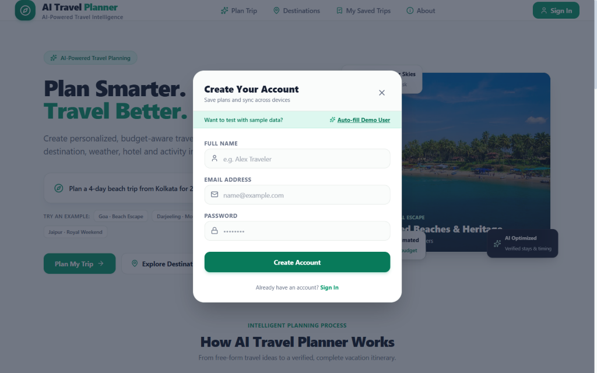
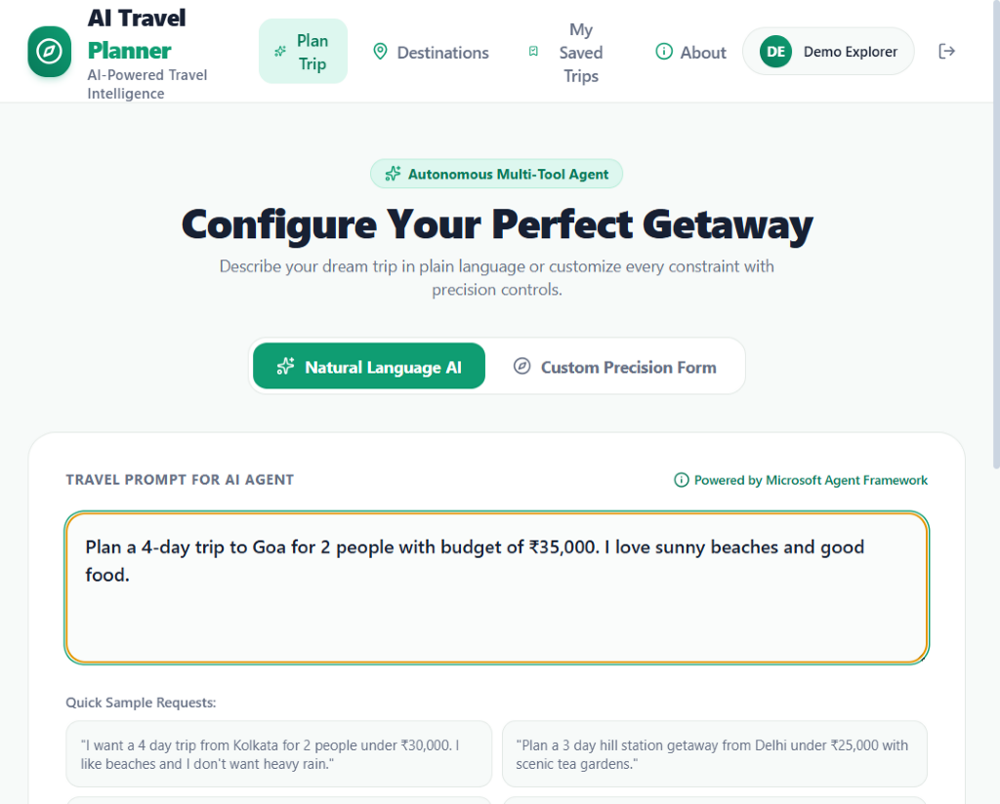
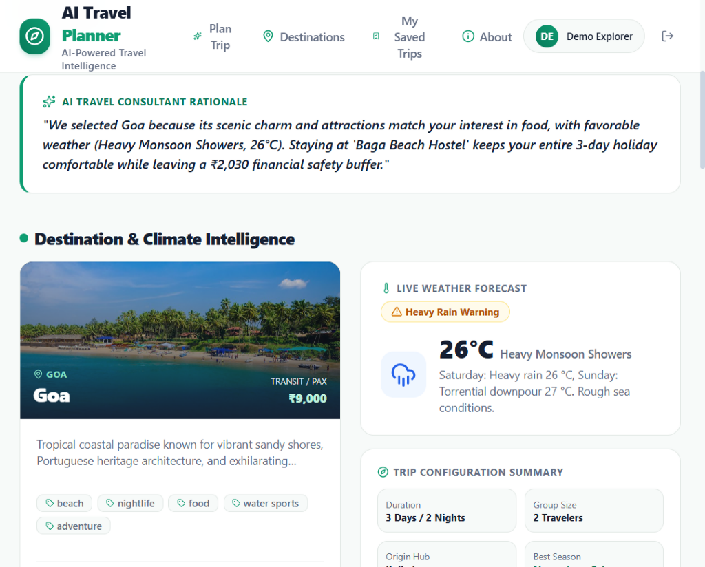
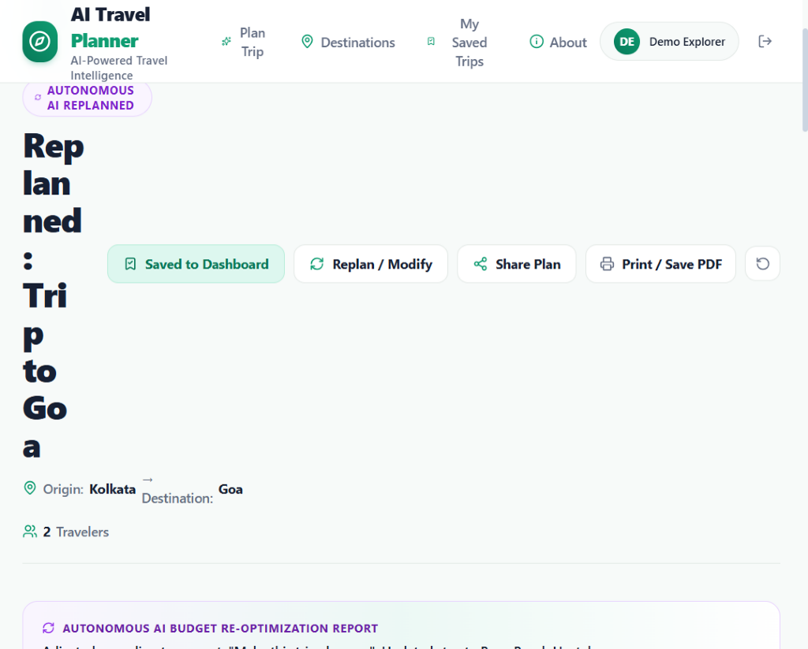
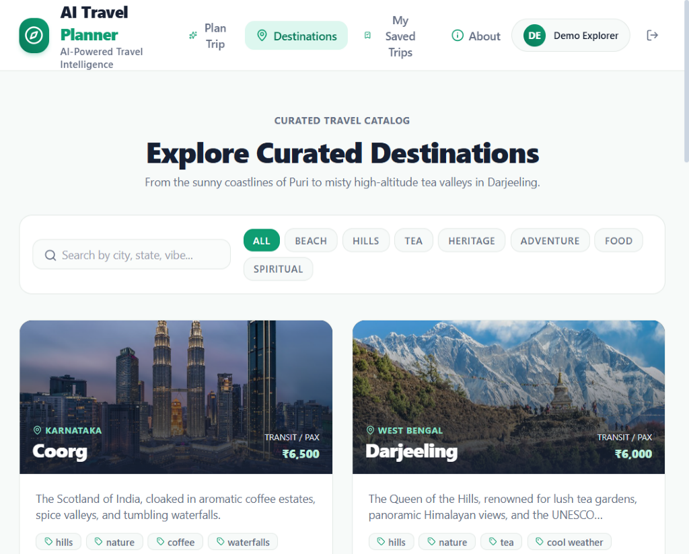
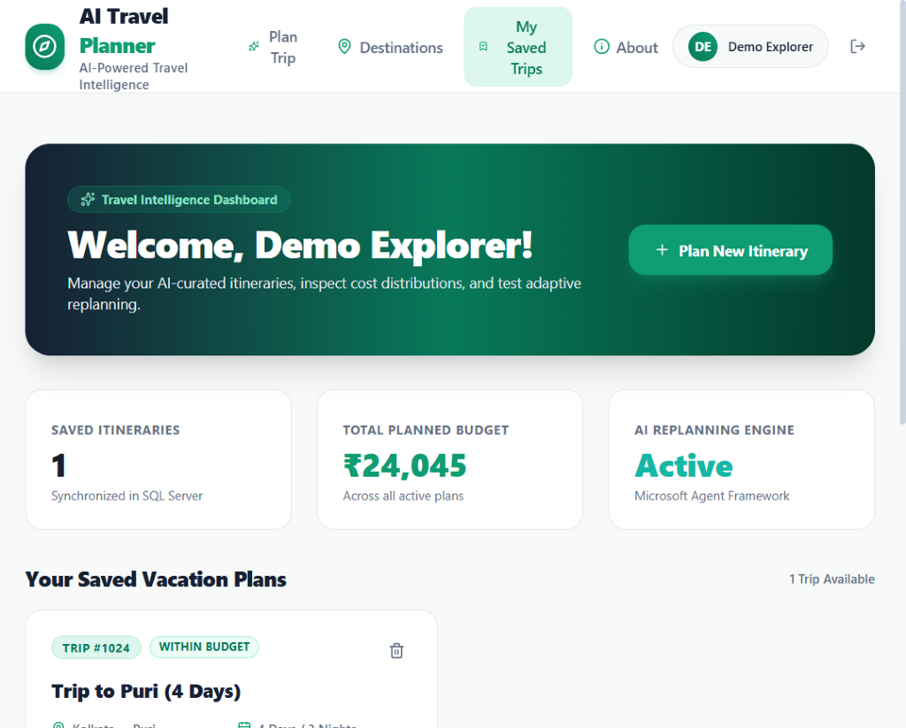
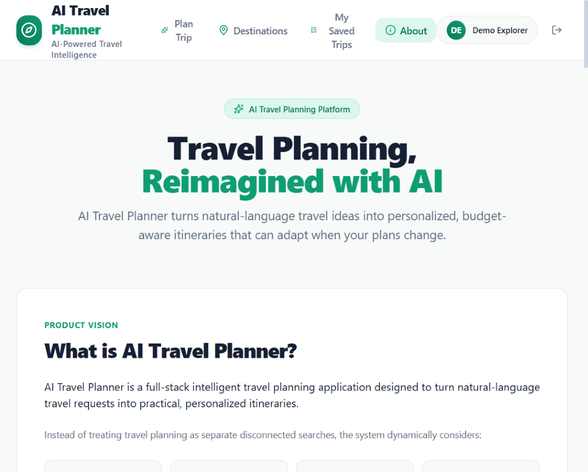

# AI Travel Planner

[](https://dotnet.microsoft.com/)
[](https://react.dev/)
[](https://tailwindcss.com/)
[](https://github.com/microsoft/agent-framework)
[](https://ollama.com/)
[](https://www.microsoft.com/sql-server)
[](https://xunit.net/)

An intelligent full-stack travel planning application that transforms natural-language vacation requests into realistic, budget-aware, and weather-aware itineraries with autonomous replanning.

---

## Overview

**AI Travel Planner** bridges the gap between conversational AI and deterministic travel logistics. Rather than generating generic text suggestions, the application evaluates user constraints—origin city, destination preferences, duration, head count, and financial ceilings—against verified destination catalogs, live meteorological data, accommodation tariffs, and daily activity schedules.

When an initial plan exceeds financial ceilings or triggers weather advisories, the autonomous replanning engine re-optimizes the itinerary through self-healing decision tiers to restore feasibility without requiring manual reconfiguration.

---

## Key Features

- **Natural-Language Trip Planning**: Accepts conversational requests (e.g., *"Plan a 4-day beach trip from Kolkata for 2 people under ₹30,000"*) and automatically extracts structured parameters.
- **AI-Powered Destination Selection**: Matches user vibes (beaches, hills, tea gardens, heritage, spirituality) with handpicked destinations.
- **Weather Intelligence**: Inspects regional forecasts and seasonal alerts (e.g. heavy monsoon showers) to safeguard outdoor activities.
- **Curated Accommodation Matching**: Evaluates verified hotel catalogs to balance price-per-night with user budget caps and guest ratings.
- **Comprehensive Budget Calculation**: Deterministic calculation across transit, lodging, dining, activities, and emergency safety buffers in INR (₹).
- **Day-by-Day Itinerary Generation**: Creates structured morning, afternoon, and evening schedules with itemized daily costs and packing advice.
- **Autonomous AI Replanning**: Cascading multi-tier solver that automatically recovers over-budget or weather-disrupted trips.
- **Multi-Tier Budget Optimization**: Three distinct replanning levels (lodging downgrade, sibling destination pivot, activity scaling).
- **Persistent Saved Itineraries**: Confirms and saves customized travel itineraries directly to a relational SQL Server database.
- **"My Saved Trips" Dashboard**: Personalized management portal providing trip details, financial summaries, and one-click itinerary reloading.
- **User-Specific Trip Isolation**: Strict authorization policies ensuring users access and manage only their own saved itineraries.
- **Searchable Destination Catalog**: Filterable catalog supporting search by keyword, state, and category tags (ALL, BEACH, HILLS, TEA, HERITAGE, ADVENTURE, FOOD, SPIRITUAL).
- **PDF & Print-Ready Formatting**: Specialized print stylesheet hiding interactive controls while preserving bounded pricing cards and itinerary breakdowns.
- **Secure Authentication**: Stateless JWT Bearer token authentication with salted BCrypt password hashing.

---

## Autonomous AI Replanning

The core differentiator of AI Travel Planner is its self-healing replanning architecture. When an itinerary exceeds the target budget or encounters constraints, the engine executes a three-tier optimization cascade:

1. **Tier 1 — Accommodation Optimization**:
   Maintains the selected destination while switching from premium lodging to vetted, high-rated boutique or economy accommodations. The lodging delta is recomputed into the budget.
2. **Tier 2 — Sibling Destination Rerouting**:
   If hotel downgrades alone cannot meet the budget ceiling, the engine searches alternative sister destinations offering equivalent vibes with significantly lower transit fares (e.g., recommending Puri over Goa).
3. **Tier 3 — Activity & Duration Optimization**:
   Calibrates discretionary tour admissions and schedule allocations to guarantee a positive remaining safety margin.
4. **Transparent AI Explanation**:
   Every replanned itinerary includes a clear breakdown explaining why the adjustment was made and detailing the exact rupee savings achieved.

---

## Technology Stack

### Backend
- **Framework**: .NET 10 / ASP.NET Core Web API
- **Language**: C# 13
- **Architecture**: Clean Architecture (Domain-Driven, Layered, Inward Dependency Rule)
- **Agent Orchestration**: Microsoft Agent Framework (`Microsoft.Agents.AI`, `Microsoft.Extensions.AI`)
- **Data Access**: Entity Framework Core 10 (Code-First with automatic migrations & seeding)
- **Database**: Microsoft SQL Server LocalDB (`(localdb)\mssqllocaldb`)

### Artificial Intelligence
- **Inference Runtime**: Ollama (Port 11434)
- **Foundation Model**: Llama 3.2
- **Execution Mode**: Local on-device AI inference (private, low-latency, zero API billing)

### Frontend
- **Framework**: React 19 Single-Page Application
- **Language**: TypeScript (strict type checking)
- **Build Tool**: Vite
- **Styling**: Tailwind CSS (Emerald Luxury design system)
- **Icons**: Lucide React
- **HTTP Client**: Axios with request/response interceptors for JWT injection and 401 handling

### Testing & Verification
- **Test Framework**: xUnit 2.9
- **Mocking**: Moq
- **Assertions**: FluentAssertions
- **Test Suite**: 20 passing unit & integration tests covering domain rules, budget math, replanning tiers, and auth security.

### Security
- **Authentication**: JWT Bearer Tokens (HMAC-SHA256)
- **Password Hashing**: BCrypt with unique cryptographic salt
- **Authorization**: User-isolated relational queries preventing cross-user data exposure

---

## Architecture

The backend strictly follows Clean Architecture principles:

```text
React 19 Frontend (TypeScript + Tailwind CSS)
      │
      ▼ [RESTful JSON API / JWT Bearer]
AITravelPlanner.API (Controllers, Middleware, Swagger OpenAPI)
      │
      ▼
AITravelPlanner.Application (Use Cases, DTOs, Agent Tools, Replanning Heuristics)
      │
      ├───────────────────────────────┐
      ▼                               ▼
AITravelPlanner.Domain          AITravelPlanner.Infrastructure
(Entities, Enums, Rules)        (EF Core, SQL Server, Ollama, JWT, BCrypt)
```

- **Domain (`AITravelPlanner.Domain`)**: Core business entities (`Trip`, `Destination`, `Hotel`, `Activity`, `ItineraryDay`, `SavedPlan`, `User`) and enums (`TripStatus`, `TimeOfDay`). Zero external package dependencies.
- **Application (`AITravelPlanner.Application`)**: Service interfaces, orchestration services (`TravelPlanningService`, `ReplanningService`, `BudgetService`), DTOs, and Microsoft Agent Framework tool definitions (`TravelTools`).
- **Infrastructure (`AITravelPlanner.Infrastructure`)**: Implementations of repositories, `TravelDbContext`, `OllamaService`, `MockWeatherService`, and security tokens.
- **API (`AITravelPlanner.API`)**: HTTP endpoints, dependency injection configuration, exception handling middleware, and OpenAPI documentation.
- **Frontend (`frontend/AITravelPlanner.Web`)**: Component-driven single-page app organized into components, pages, context, and typed API service clients.

---

## Application Flow

```text
User Natural-Language Request
      │
      ▼
AI Travel Planning Service
      │
      ▼
Microsoft Agent Framework
      │
      ├── Tool: SearchDestinations (matching vibes & transit)
      ├── Tool: GetWeatherForecast (regional climate & rain risks)
      ├── Tool: SearchHotels (rate filtering & guest ratings)
      └── Tool: CalculateBudget (transit + lodging + food + excursions + 5% buffer)
      │
      ▼
Autonomous Replanning Gate
      │  ├─ Within Budget? ──> Proceed to Schedule Generation
      │  └─ Over Budget?   ──> Execute 3-Tier Cascade Solver (Hotel -> Destination -> Activities)
      │
      ▼
Day-by-Day Itinerary Generation (Morning, Afternoon, Evening, AI Rationale)
      │
      ▼
Final Verified Travel Plan (Save to Dashboard / Print to PDF)
```

---

## Local Setup

### Prerequisites
1. **.NET 10 SDK** (installed and available on PATH)
2. **Node.js** (v18+) & **npm**
3. **Microsoft SQL Server LocalDB** (included with Visual Studio or SQL Server Express)
4. **Ollama** ([ollama.com](https://ollama.com))

### 1. Start Ollama with Llama 3.2
```bash
ollama run llama3.2
```
Ensure Ollama is running and accessible on `http://localhost:11434`.

### 2. Run Backend Web API
```bash
cd E:\asp.net\AITravelPlanner\AITravelPlanner.API
dotnet run --urls "http://localhost:5000"
```
> Database creation and seed data initialization occur automatically on first startup via EF Core Code-First. No manual database setup is required.

### 3. Run Frontend Web Application
In a new terminal:
```bash
cd E:\asp.net\AITravelPlanner\frontend\AITravelPlanner.Web
npm install
npm run dev
```

### URLs
- **Frontend App**: [http://localhost:5173](http://localhost:5173)
- **Backend API**: [http://localhost:5000](http://localhost:5000)
- **Swagger Documentation**: [http://localhost:5000/swagger](http://localhost:5000/swagger)
- **Ollama Engine**: [http://localhost:11434](http://localhost:11434)

---

## Testing & Verification

### Backend Tests
Execute the xUnit test suite from the root directory:
```bash
dotnet test
```
**Expected Output:**
```text
Passed!  - Failed: 0, Passed: 20, Skipped: 0, Total: 20
```

### Frontend Build
Verify that TypeScript compiles with zero errors:
```bash
cd E:\asp.net\AITravelPlanner\frontend\AITravelPlanner.Web
npm run build
```
**Expected Output:**
```text
✓ built in ~3-5s (0 errors, 0 warnings)
```

---

## Screenshots

### 1. Homepage & Intelligent Travel Hero
An intuitive split-layout hero integrating conversational prompt inputs, quick example pills, and live weather/budget signals.


### 2. User Authentication (Sign In & Sign Up)
Secure JWT-based authentication with local account registration and instant demo user access.

| Sign In | Create Account |
| :---: | :---: |
|  |  |

### 3. Plan Trip Interface
Natural-language vacation prompt with customizable destination, duration, travelers, and budget ceiling.


### 4. AI-Generated Travel Itinerary
Multi-tool planning synthesis featuring destination weather risk evaluation, vetted hotel cards with bounded pricing, and itemized daily schedules.


### 5. Autonomous AI Replanning
Self-healing optimization triggered when financial constraints or preferences shift, displaying transparent savings rationale.


### 6. Destinations Explorer & Curated Catalog
Curated Indian destination catalog with category tag filtering (`BEACH`, `HILLS`, `TEA`, `HERITAGE`, etc.) and one-click *"Plan Here"* action.


### 7. "My Saved Trips" Dashboard
Personalized management dashboard tracking confirmed itineraries, aggregate budget allocations, and single-click full itinerary reload.


### 8. About & Architecture Narrative
Product-first narrative illustrating the 4-phase intelligence cycle and Clean Architecture pipeline.


---

## Deployment Note

The current version of AI Travel Planner is engineered to run locally using on-device **Ollama** with the **Llama 3.2** model to provide private, zero-subscription inference during development and recruiter demonstrations. 

The AI orchestrator is decoupled via the `IAIService` abstraction, allowing production deployments to seamlessly connect to managed cloud AI providers (such as Azure OpenAI, AWS Bedrock, or Google Cloud Vertex AI) by providing cloud configuration values in `appsettings.Production.json`.

---

## Project Structure

```text
AITravelPlanner/
├── AITravelPlanner.slnx                     # Visual Studio Solution File (.NET 10)
├── README.md                                # Project Portfolio Documentation
├── .gitignore                               # Git Exclusions
│
├── AITravelPlanner.Domain/                  # Core Business Entities & Enums
│   ├── Entities/                            # Trip, Destination, Hotel, Activity, ItineraryDay, SavedPlan, User
│   └── Enums/                               # TripStatus, TimeOfDay
│
├── AITravelPlanner.Application/             # Business Logic & Abstractions
│   ├── Agents/                              # TravelPlannerAgent (Microsoft Agent Framework)
│   ├── DTOs/                                # Request & Response Data Transfer Objects
│   ├── Interfaces/                          # Service Contracts (IAIService, ITripRepository, etc.)
│   ├── Services/                            # TravelPlanningService, ReplanningService, BudgetService
│   └── Tools/                               # TravelTools (Destination, Weather, Hotel, Budget tools)
│
├── AITravelPlanner.Infrastructure/          # Data Access, Security & External Services
│   ├── Configuration/                       # Options pattern models (OllamaOptions, JwtOptions)
│   ├── Data/                                # TravelDbContext, SeedData
│   ├── ExternalServices/                    # OllamaService (Llama 3.2 client), MockWeatherService
│   ├── Repositories/                        # TripRepository, DestinationRepository, HotelRepository, UserRepository
│   └── Security/                            # JwtTokenService, PasswordHasher (BCrypt)
│
├── AITravelPlanner.API/                     # Presentation Web API Layer
│   ├── Controllers/                         # Auth, Trips, Destinations, Hotels, Health
│   ├── Middleware/                          # Global Exception Handling Middleware
│   ├── appsettings.json                     # Local Connection Strings & Service Configurations
│   └── Program.cs                           # Dependency Injection & Pipeline Setup
│
├── AITravelPlanner.Tests/                   # Automated xUnit Test Suite (20 Tests)
│   ├── BudgetCalculationTests.cs            # Mathematical formula & room allocation tests
│   ├── ReplanningServiceTests.cs            # Multi-tier recovery fallback tests
│   └── SecurityAndValidationTests.cs        # BCrypt, JWT, and Model validation tests
│
├── database/                                # SQL Reference Scripts
│   ├── schema.sql                           # Database DDL script
│   └── seed_data.sql                        # Destination and hotel seed script
│
├── docs/                                    # Technical Architecture Guides
│   ├── architecture.md                      # Clean Architecture documentation
│   ├── api.md                               # REST API specifications
│   ├── database.md                          # Schema & ER diagram documentation
│   ├── ai-workflow.md                       # Agent tool calling & replanning flow
│   └── screenshots/                         # Walkthrough screenshots
│
└── frontend/AITravelPlanner.Web/            # React 19 Single-Page Application
    ├── src/
    │   ├── components/                      # Navbar, Footer, DestinationCard, HotelCard, etc.
    │   ├── context/                         # AuthContext (JWT session management)
    │   ├── pages/                           # LandingPage, PlannerPage, ResultsPage, DashboardPage, etc.
    │   ├── services/                        # Axios HTTP API clients
    │   └── types/                           # TypeScript interfaces
    ├── tailwind.config.js                   # Tailwind CSS Theme & Styling
    └── vite.config.ts                       # Vite Configuration & Backend Proxy
```

---

## Author

**Built by Nishat Tamanna Kabir**  
*Software Engineer · .NET & AI Developer*  
A full-stack project combining modern .NET 10 engineering, React development, and local AI orchestration.
